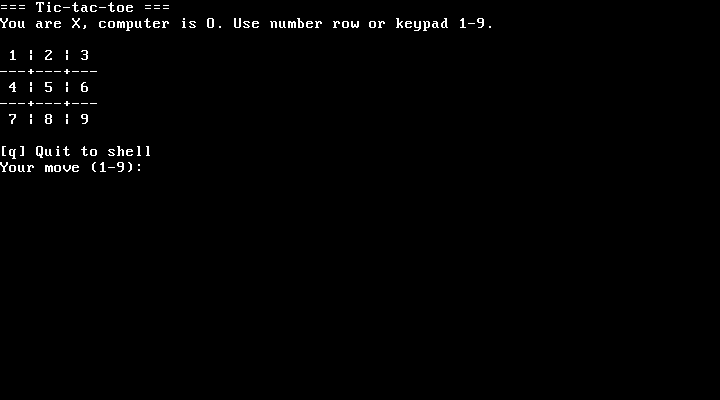

# osfork

An experimental 32-bit x86 bare-metal kernel for learning systems programming. osfork currently boots in QEMU and provides a VGA text terminal, a keyboard-driven shell, a small virtual filesystem with disk-backed snapshots, a local text-page viewer, and tic-tac-toe.

This is an early educational project, not a general-purpose operating system. Hardware support, process isolation, networking, and a standard on-disk filesystem are not implemented.



## Current features

- Multiboot-compatible 32-bit x86 kernel entry
- VGA text-mode terminal and PS/2 keyboard input
- Shell commands including `help`, `ls`, `cd`, `cat`, `mkdir`, `touch`, and `rm`
- `browse`: view built-in text pages; this does not access the internet
- `game`: play tic-tac-toe against a simple computer opponent
- QEMU IDE disk snapshots that preserve filesystem entries across launches

Interrupt, scheduler, and user-mode transition code is experimental groundwork and is not enabled by the stable boot path.

## Requirements

- Windows PowerShell
- LLVM/Clang installed at `C:\Program Files\LLVM\bin`, or adjust the path in `build.ps1`
- QEMU for x86, installed at `C:\Program Files\qemu` or available on `PATH`

## Run

From the repository directory:

```powershell
.\run.ps1
```

This builds the kernel, creates the persistent disk image if needed, and opens QEMU in a GTK window. Click the guest window to give it keyboard focus. At the `osfork>` prompt, try `help`, `browse`, or `game`.

Alternative display backends:

```powershell
.\run.ps1 -Display sdl
.\run.ps1 -Display curses
```

Build only, without starting QEMU:

```powershell
.\build.ps1
```

## Persistent filesystem

`run.ps1` creates `build\osfork-data.img`, a dedicated 16 MiB virtual IDE disk. The current filesystem snapshot is saved after `mkdir`, `touch`, and `rm`, then restored on the next launch. Keep this image to retain files; deleting it resets the filesystem to its default contents. The snapshot format is project-specific and is not a general-purpose disk filesystem.

## Release status

osfork is intended for QEMU experimentation. It has not been validated as a bootable installation for physical computers. See [CHANGELOG.md](CHANGELOG.md) for the current preview notes.

## Contributing and license

Contributions are welcome; see [CONTRIBUTING.md](CONTRIBUTING.md) for the workflow and starter tasks. osfork is released under the [MIT License](LICENSE), which permits commercial use and redistribution subject to its terms.
